# Evidence: every chart and image, and what it shows

In the order the work happened. Each picture names the script that made it and the gate or receipt it belongs to; the numbers quoted are the ones recorded at the time in the [history](history.md). Videos are rendered by the same scripts but stay local, see [outputs](outputs.md).

## 1. The 2D reference (milestone 2, September 2026)

`reference2d/pfflip2d.py`, three scenes.

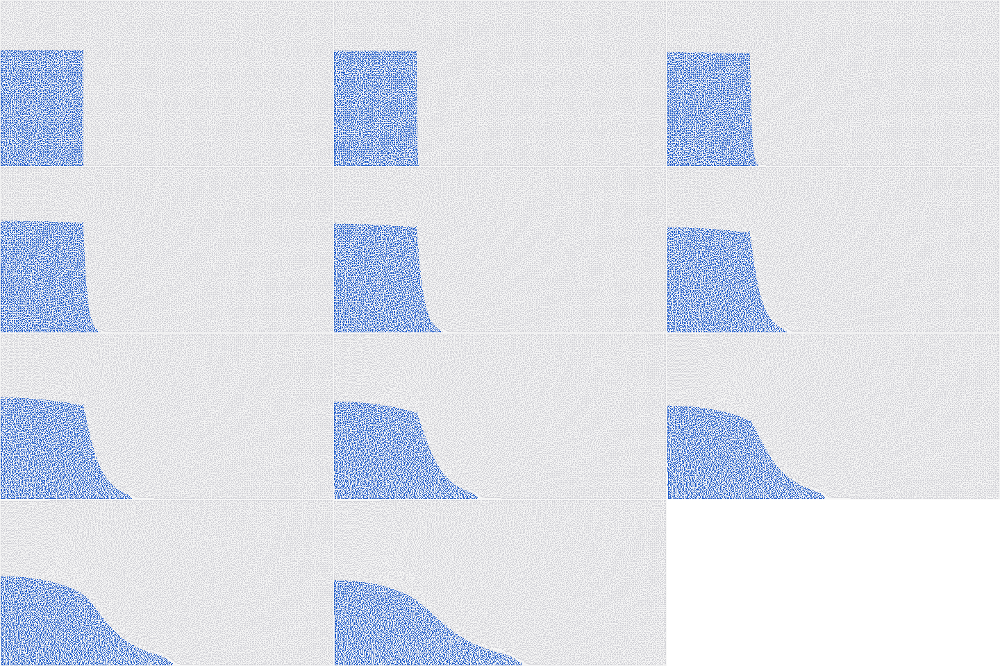

A collapsing column running along the floor under air; the front advances monotonically, mildly damped by the FLIP blend.

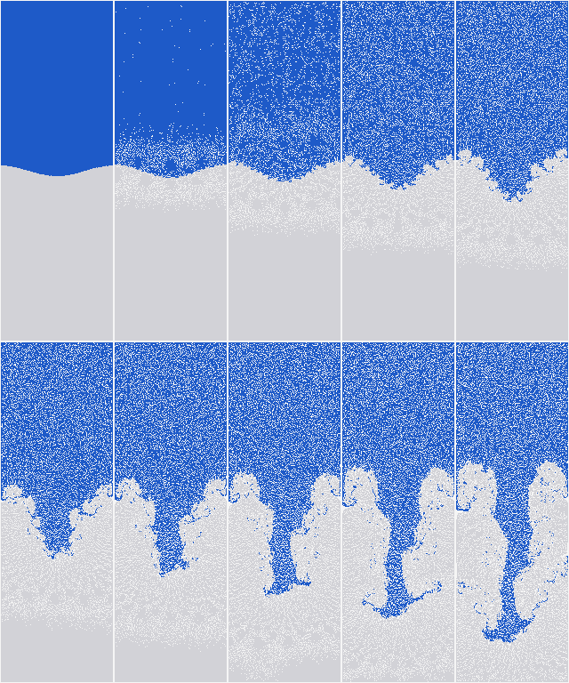

Heavy fluid over light at Atwood 0.9, the paper's own validation setup. Fingers grow from a seeded ripple into mushrooms; a single-phase solver cannot produce this at all.

## 2. The validation gate (milestone 3, 2026-09-30)

`reference2d/validation.py`; verdicts in [VALIDATION.md](../reference2d/VALIDATION.md).

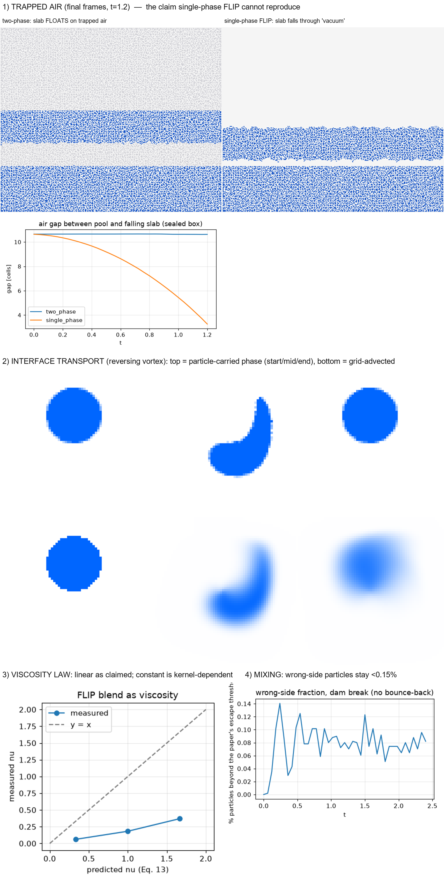

The overview sheet of the four experiments.

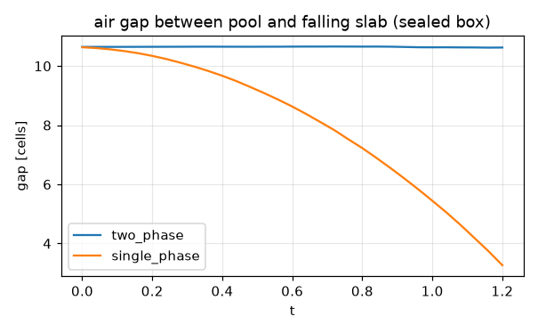

Claim 1, supported decisively: a slab falls on a sealed pocket of air. The two-phase slab settles on the cushion and the gap holds at 10.6 cells; the single-phase slab falls through its vacuum, 10.6 down to 3.3 and still accelerating. The frame strips: single-phase above, two-phase below.

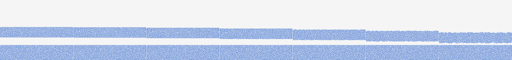
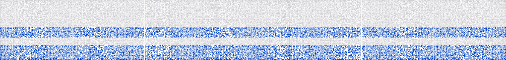

Claim 2, supported with a caveat: the reversing-vortex benchmark. The grid scalar loses the thin filament to numerical diffusion (L1 error 293 cell units); the particle-carried phase returns essentially exact.

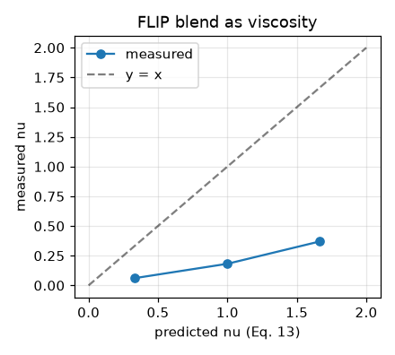

Claim 3, the law holds, the constant is ours: measured viscosity is proportional to (1 - alpha) / dt, but the constant is about 1/30 rather than the paper's 1/6, which belongs to their kernels. Calibrate per implementation.

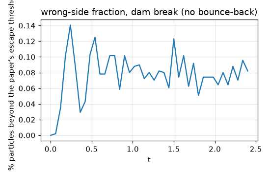

Claim 4, supported: the wrong-side particle fraction in the dam break peaks at 0.14 percent and does not grow.

`reference2d/compare_frames.py`: plain single-phase FLIP (top row) against PF-FLIP (bottom row), same scene, same seeds, same instants.

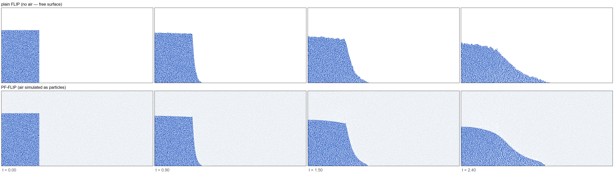

The dam break, where air escapes freely: broadly similar, the honest negative control.

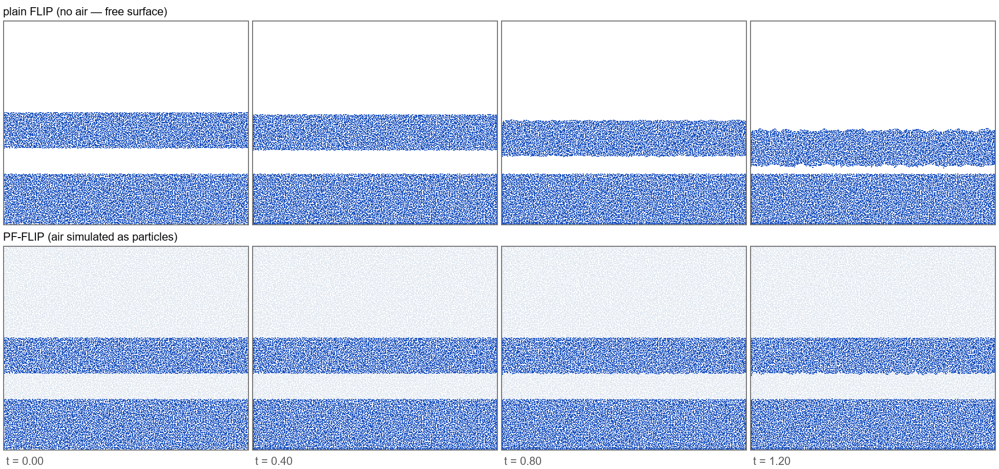

The sealed air cushion, where only PF-FLIP has the physics.

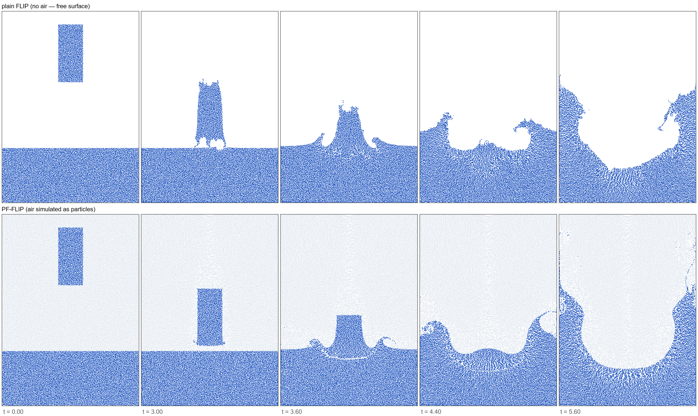

The plunge: trapped pockets and a cushioned crash against a free fall.

## 3. The phase field from stock nodes (milestone 4, 2026-09-30)

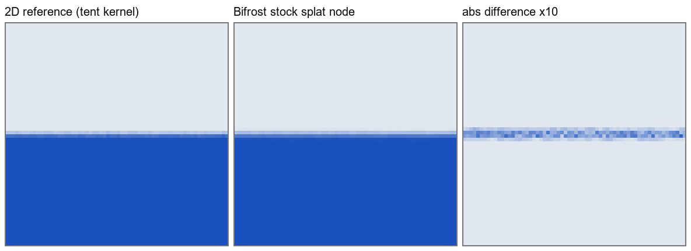

`gates/compare_phase_field.py`: the same jittered slab splatted by Bifrost's stock node and by the reference. Mean difference 0.002, maximum 0.08 confined to the one-voxel interface band, interface midpoint within 0.03 voxels.

## 4. The loop inside Bifrost (milestone 5, 2026-10-05)

`gates/validate_loop.py`: the whole simulation inside one headless graph, against the reference and against physics.

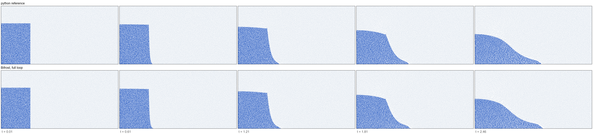

Side by side with the reference; the front stays within 1.9 cells over the full run (1.0 cell once the fused transfer replaced the stock kernel).

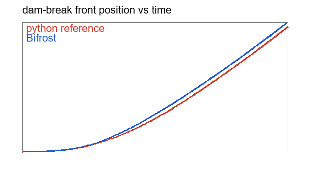
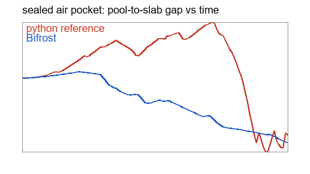

The front-position curve, and the sealed cushion's gap holding at 10.6 cells with no reference in the loop.

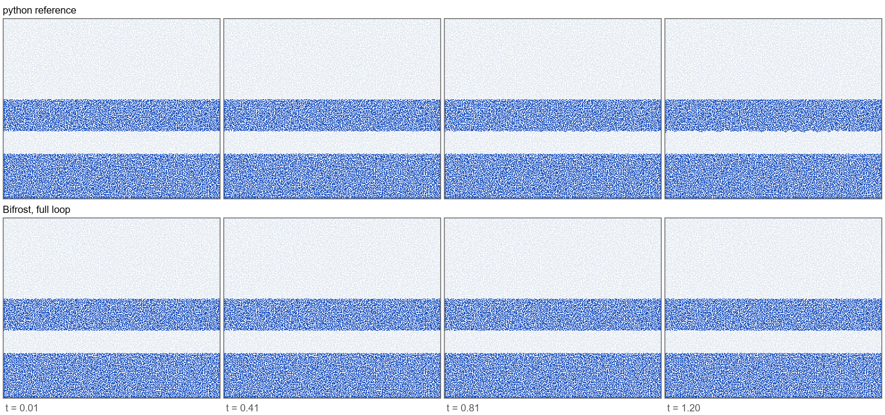
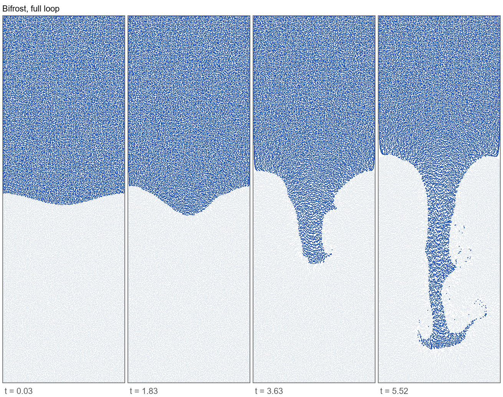

The physics anchors: the air cushion and 19:1 Rayleigh-Taylor growing textbook mushrooms.

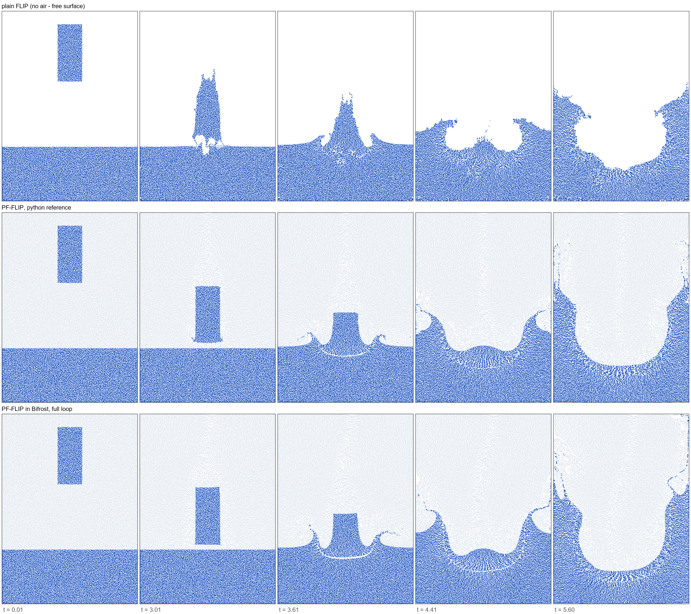

`experiments/demo_splash.py`: the violent three-way plunge. Air-jet speeds reach 505 cells per second as the trapped film squirts out at impact, CFL 5 at that instant; the measured reason milestone 6 needed adaptive stepping.

## 5. ST-FLIP in 2D (milestone 6, October 2026)

`reference2d/st_compare.py`: each scene three ways, the trusted small dt, PF-FLIP at a large dt, and ST-FLIP at the same large dt.

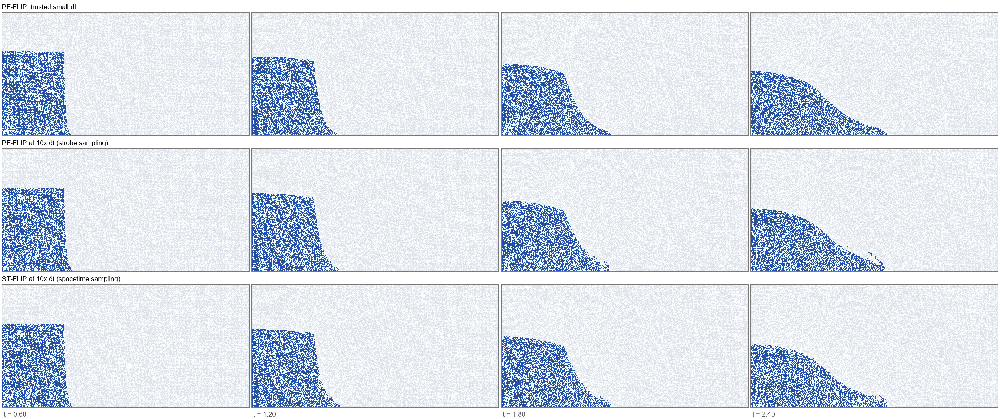
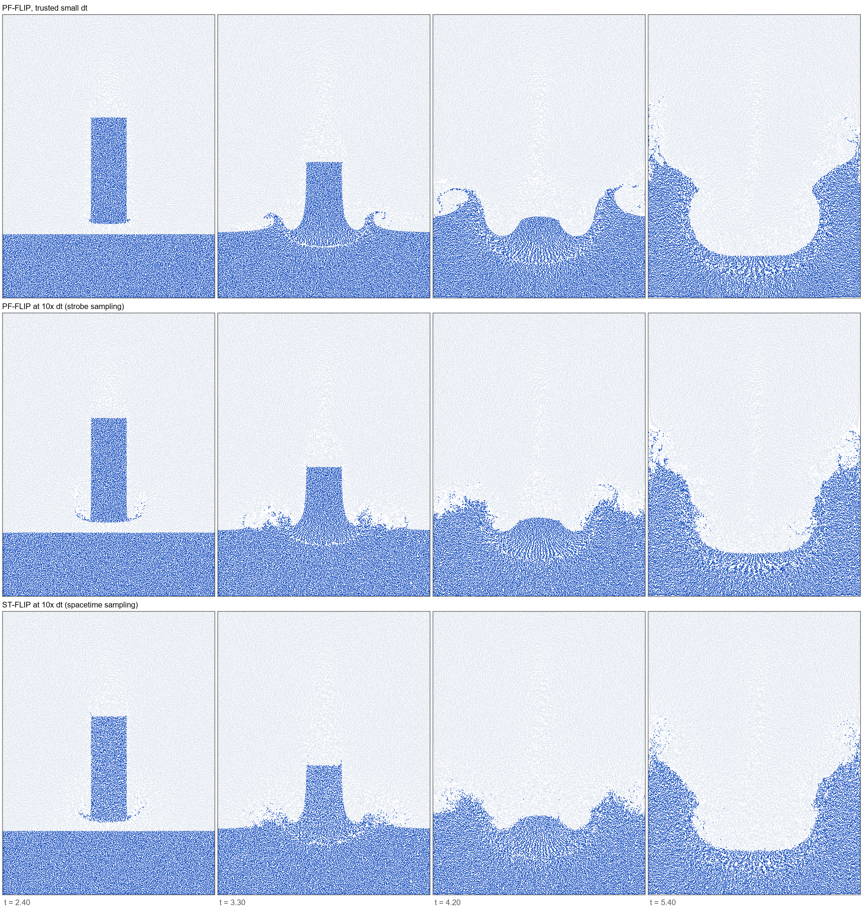

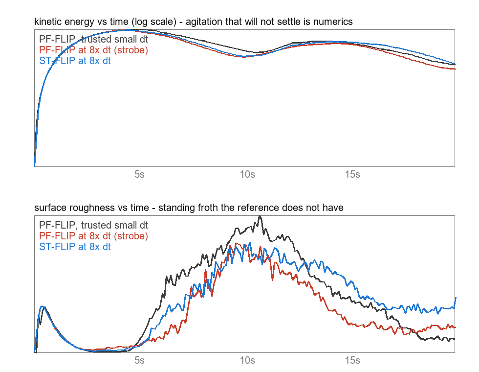

`reference2d/st_energy.py`: kinetic energy and surface roughness against time; aliasing shows as sustained agitation the reference does not have.

## 6. The fused transfer layer (milestone 6.75, 2026-10-09)

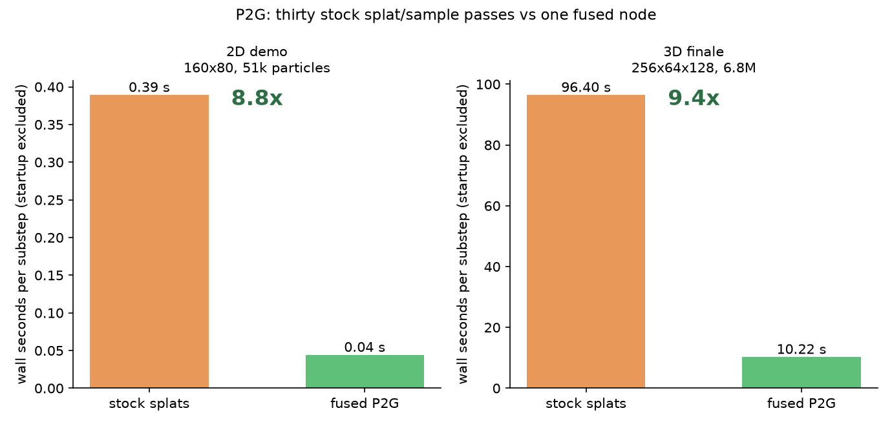

`experiments/demo_p2g_speed.py`, receipts in [p2g_speed_summary.json](../results/p2g/p2g_speed_summary.json): the same 20-second bore through the stock-splat graph and the fused node. At finale scale, 96.4 s a substep to 10.22 s, 9.4x (`experiments/bench_p2g_finale.py`); 8.8x on the 2D demo. The side-by-side video with live clocks is local.

## 7. Threading (2026-10-10)

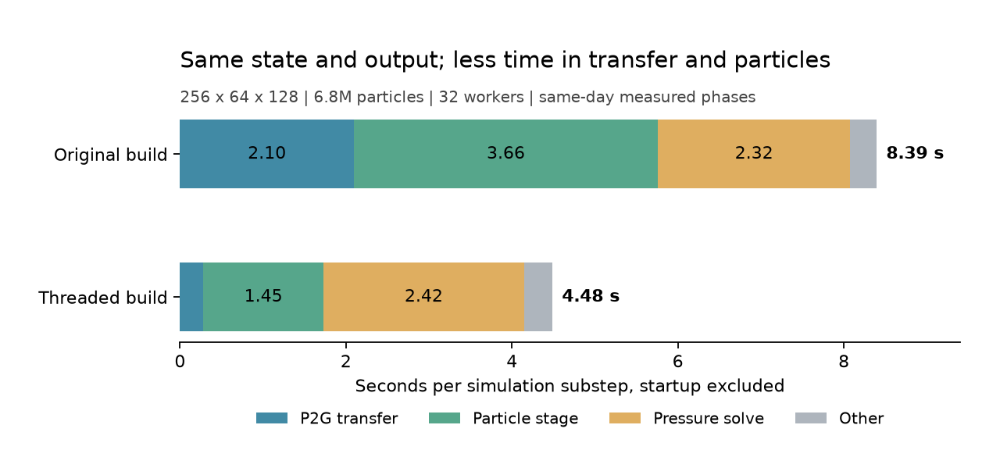

`experiments/threading_experiment.py`, the record in [results/threading/README.md](../results/threading/README.md) with [receipts.json](../results/threading/receipts.json) and [validation.txt](../results/threading/validation.txt): destination-owned slabs, every saved array bit-identical to the serial build, 8.3 to 4.5 s a substep at 32 workers, then 3.66 s with the solve sweep threaded.

## 8. The adaptive pressure solve (milestone 6.5, 2026-10-10 to 2026-10-13)

Gates: [stage1_gate.json](../reference2d/results/adaptive/stage1_gate.json) and [stage3a_gate.json](../reference2d/results/adaptive/stage3a_gate.json) from `reference2d/validate_adaptive_solve.py` and `validate_adaptive_projection.py`.

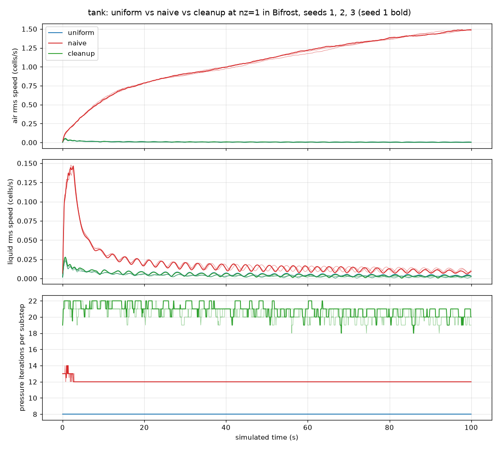

`experiments/adaptive_long_run.py`, [long_run_tank.json](../results/adaptive/long_run_tank.json): a half-full tank at rest for 100 s under the uniform, naive and cleanup solves, three seeds each. Cleanup is indistinguishable from uniform; naive's air stirring grows without levelling off, 1.49 cells per second at frame 2000, 430x uniform's.

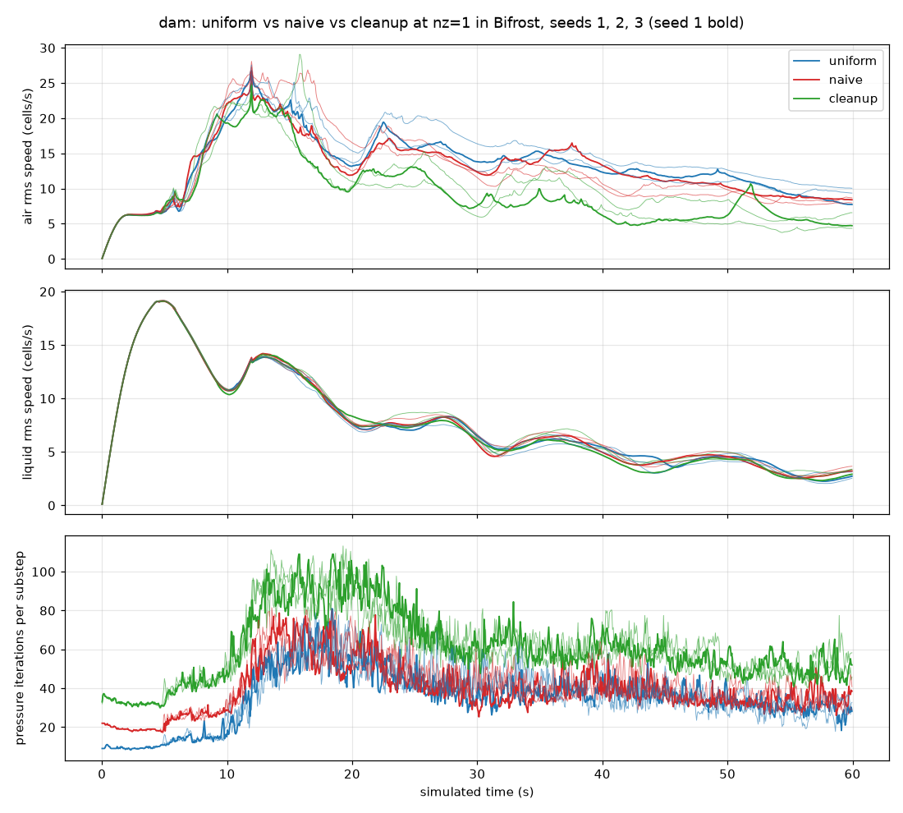

[long_run_dam.json](../results/adaptive/long_run_dam.json): the dam break for 60 s. Every arm inside the uniform seed bar at every checkpoint; iterations per substep 36 uniform, 40 naive, 60 cleanup.

[cost_indicative.json](../results/adaptive/cost_indicative.json), `experiments/adaptive_cost.py`: one finale-size step, no obstacles. The pressure phase costs 612 ms uniform, 2237 naive and 4336 cleanup at 1e-6; most of it is setup rebuilt every step.

## 9. The bore suite (milestone 6, 2026-10-08)

[summary.json](../results/bore_suite/summary.json), `experiments/run_bore_suite.py`, judged against Stoker's analytic bore speed.

| Configuration | Grid | Bore speed / Stoker | Wall |
| --- | --- | --- | --- |
| Trusted (small dt) | 80 x 32 x 40 | 1.059 | 86 min |
| ST at 8x dt | 80 x 32 x 40 | 1.063 | an eighth of trusted |
| Production (ST + adaptive particles) | 80 x 32 x 40 | 0.916 | 16.6x cheaper than trusted |
| Finale, production | 256 x 64 x 128 | 0.983 | 107 min |

## 10. The showcases (2026-10-14 and 2026-10-15)

Numbers only, in `out/collider_showcase/*_summary.json` locally: the 256 bore over three mesh boulders (4.13 h on the stock graph, no penetrations), and the 512 run (2.40 h on the fused graph, 134 M particles seeded, 52 M at the end, 20.38 s simulated). The frames and videos are described in [outputs](outputs.md).
